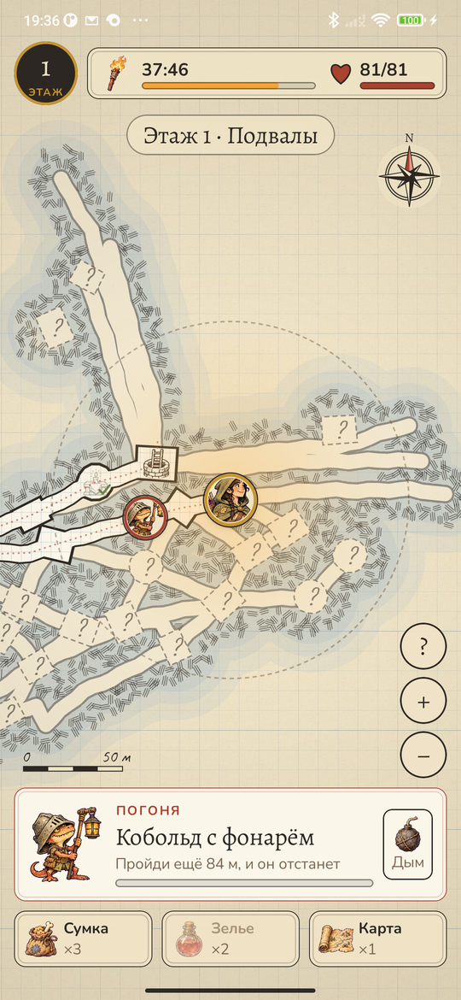
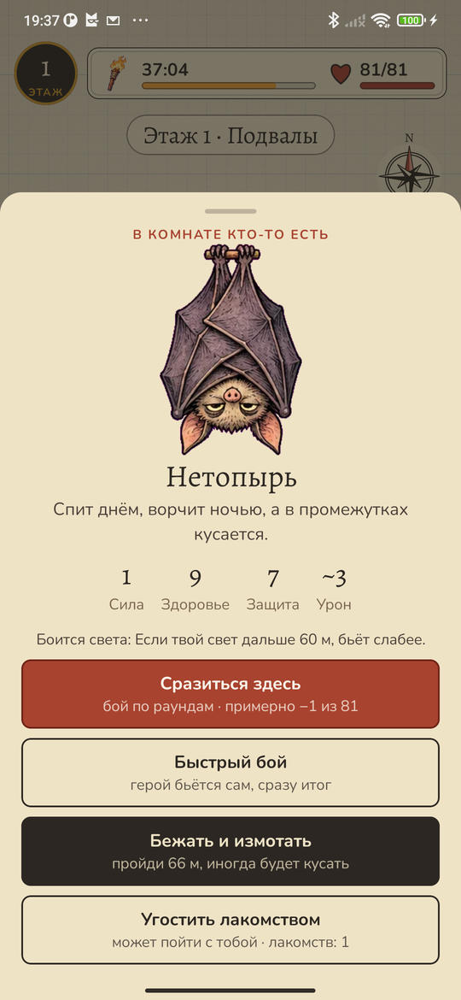
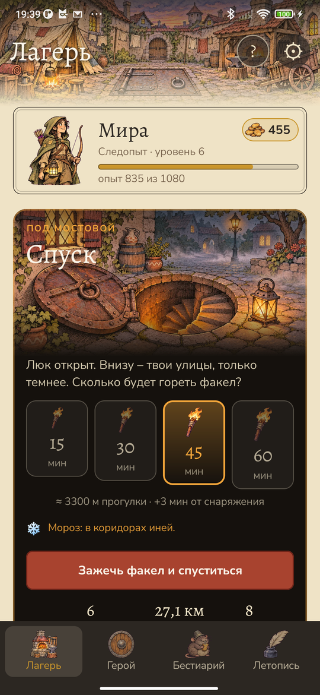
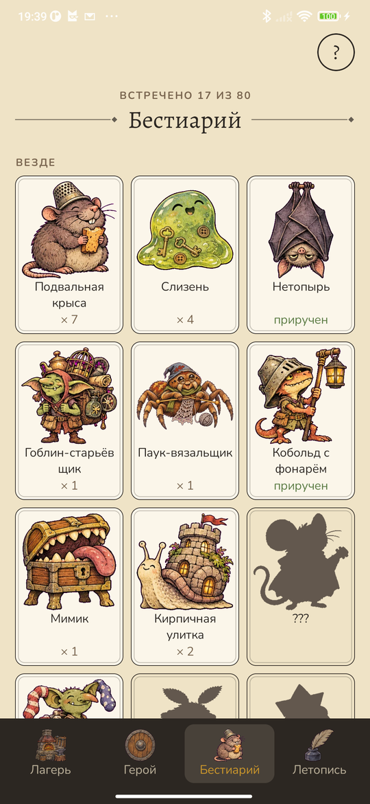

<p align="center"></p>

<h1 align="center">Delve</h1>

<p align="center">A walking game: a dungeon lies under your district, and its plan follows your streets.<br>
<a href="https://bigdevwhale.github.io/stillcraft/apps/delve/">Website</a> · <a href="https://github.com/bigdevwhale/delve/releases/latest/download/Delve.apk">Download APK</a> · <a href="README.md">Русский</a></p>

Step outside, light the torch and go for a walk – while on the phone you go down into a dungeon. A street becomes a corridor, a crossing a hall, a block solid rock. Somewhere on each floor are the stairs down: the deeper, the more danger and the richer the loot. The torch is your walk's length: 15, 30, 45 or 60 minutes.

<p align="center">




</p>

## What's inside

- **A dungeon made of your streets,** from OpenStreetMap, drawn like an old map: ink walls, hatched rock, a blue grid. Only what your torch lights is shown, and walked corridors stay on the map.
- **The town above shapes the dungeon.** A church or graveyard above is a crypt below, a fountain a spring, a park a mushroom grotto, water an underground river, a shop a merchant.
- **Chases by walking.** You don't have to fight a creature: walk a couple of hundred metres and it gives up. Or fight it: two or three blows, and guard when it winds up.
- **Pocket-friendly.** The phone buzzes at a hall, in a chase and at the stairs; small finds are picked up by themselves and go into the expedition log.
- **The depth stake.** Each floor adds a quarter to coins and materials – if you come up alive through a well or by scroll. If the torch dies, half the loot stays below.
- **Deep camps.** Beat the master of the fifth, tenth or fifteenth floor and the next descent can start from a camp below it.
- **Long progression.** Four classes, twenty levels with skill pairs to choose from; gear with rarities and affixes; six camp buildings with ten levels each; daily guild orders.
- **80 hand-drawn creatures** in the bestiary, some of which can be tamed with a treat and follow you.
- **A chronicle** of every expedition with its route, depth and loot. English and Russian.

## Install

Download [Delve.apk](https://github.com/bigdevwhale/delve/releases/latest/download/Delve.apk) on an Android 9+ phone, open it and allow the install when Android asks. Allow location on first start: the dungeon is built from it and the hero follows it. On Xiaomi, Huawei and some other phones, let the app run in the background, or an expedition may stop while the phone is in your pocket.

## Privacy

No ads, accounts or analytics. Where you walk stays on your phone. Only the district's bounds go out (to download the street map) and rounded coordinates for the weather. See [PRIVACY.md](PRIVACY.md).

## Build

JDK 17+ (Android Studio's JBR works) and the Android SDK.

```
./gradlew assembleDebug                 # app.delve.dev: tap the map to walk the hero
./gradlew assembleDebug -Pdemo          # app.delve.demo: Petrogradka, no GPS
./gradlew assembleDebug -Pdemo -Pshots  # app.delve.shots: a levelled hero for screenshots
./gradlew testDebugUnitTest
```

Art made with Codex: `python tools/gen_art.py`, then `python tools/cut.py`. Map © OpenStreetMap contributors, weather by MET Norway.
