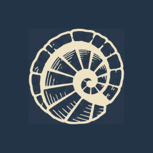
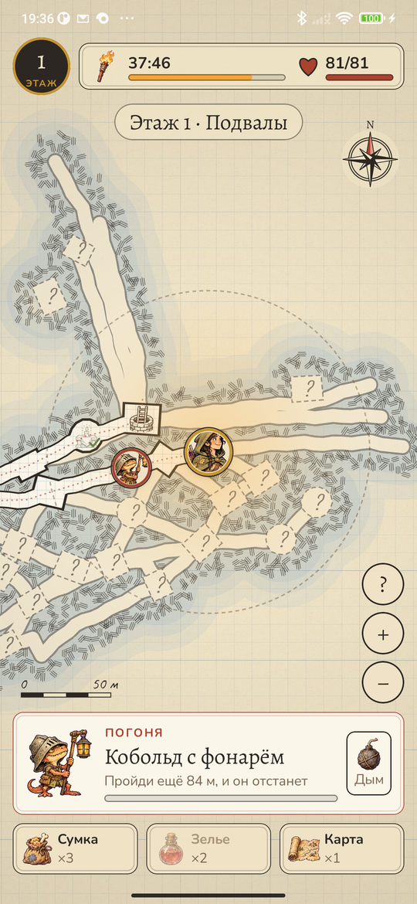
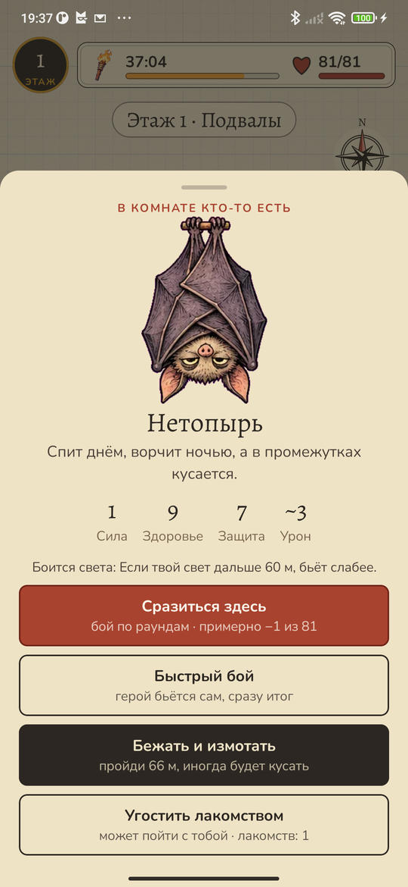
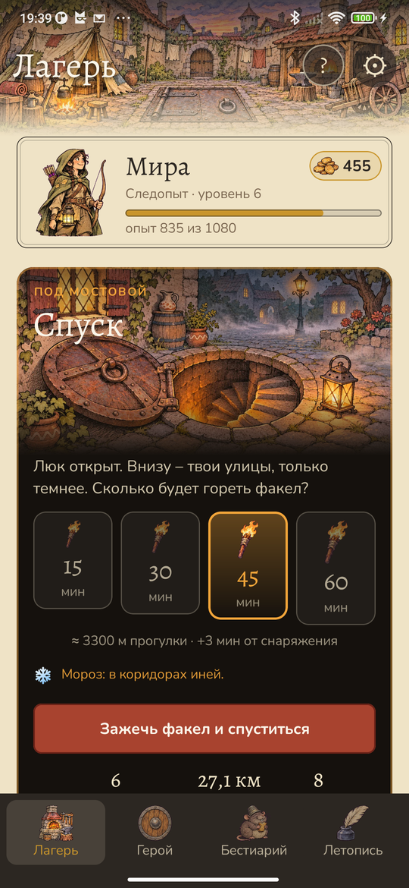
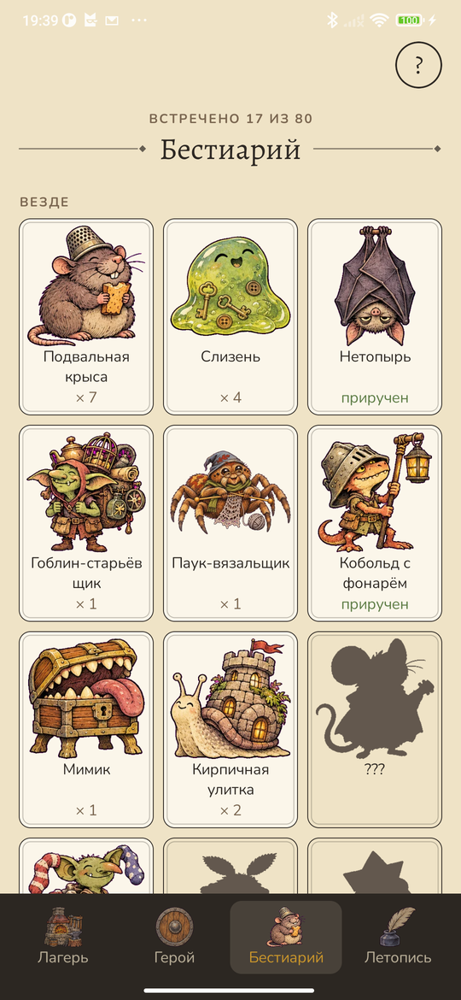
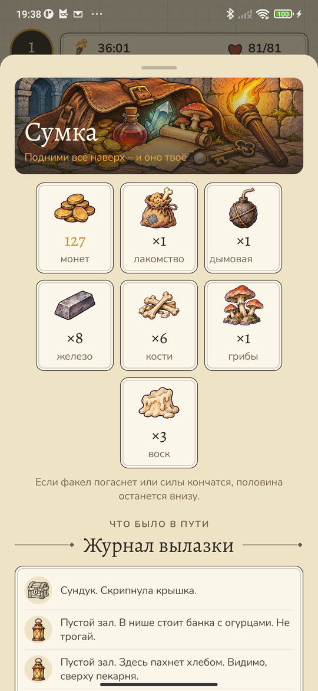
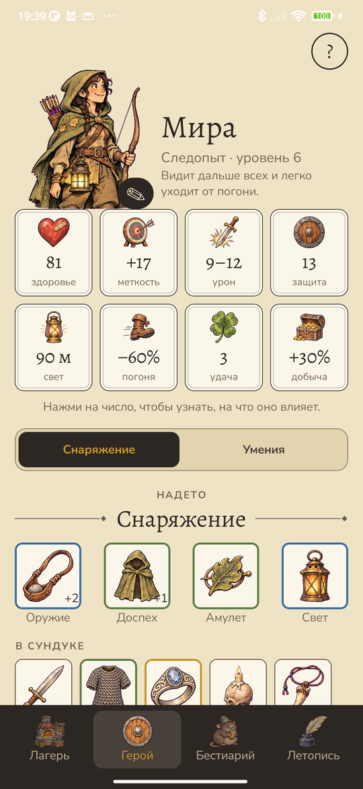
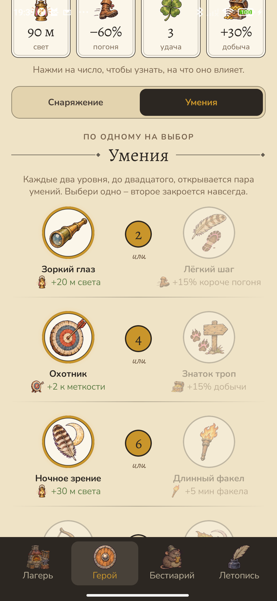
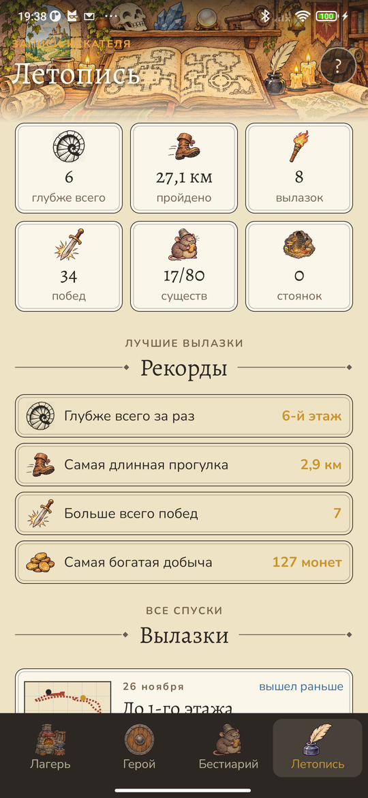

<p align="center"></p>

<h1 align="center">Подземелье</h1>

<p align="center">Игра для прогулок: под твоим районом лежит подземелье, и его план повторяет улицы.<br>
<a href="https://bigdevwhale.github.io/stillcraft/apps/delve/">Сайт</a> · <a href="https://github.com/bigdevwhale/delve/releases/latest/download/Delve.apk">Скачать APK</a> · <a href="README.md">English</a></p>

Выходишь на улицу, зажигаешь факел и идёшь гулять – а в телефоне спускаешься в подземелье. Улица в нём становится коридором, перекрёсток – залом, квартал – толщей камня. Где-то на этаже лестница вниз: чем глубже, тем опаснее и тем богаче добыча. Факел – это время прогулки: 15, 30, 45 или 60 минут.

<p align="center">




</p>

## Что внутри

- **Подземелье из твоих улиц.** Карта берётся из OpenStreetMap и рисуется как старинная карта: чернила, штриховка камня, голубая сетка. Видно только то, что освещает факел, а пройденные коридоры остаются на карте.
- **Город наверху меняет подземелье.** Под церковью или кладбищем – склеп, под фонтаном – источник, под парком – грибной грот, у воды – подземная река, под магазином – торговец.
- **Погоня шагами.** От чудовища не обязательно отбиваться: пройди пару сотен метров, и оно отстанет. А можно сразиться – бой короткий, в два-три удара, главное вовремя защититься, когда существо замахивается.
- **Телефон можно убрать в карман.** У зала, при погоне и у лестницы он вздрогнет, а мелкие находки соберутся сами и попадут в журнал вылазки.
- **Ставка глубины.** Каждый этаж прибавляет четверть к монетам и материалам – если подняться живым через колодец или по свитку. Погас факел – половина добычи останется внизу.
- **Стоянки на глубине.** Победи хозяина пятого, десятого или пятнадцатого этажа, и следующий спуск можно начать со стоянки под ним.
- **Развитие надолго.** Четыре класса, двадцать уровней и пары умений на выбор; снаряжение с редкостью и свойствами; шесть построек лагеря по десять уровней; заказы гильдии на каждый день.
- **80 существ** в бестиарии. Некоторых можно приручить лакомством – и они пойдут с тобой.
- **Летопись** хранит каждую вылазку с маршрутом, глубиной и добычей. Русский и английский.

<p align="center">




</p>

## Установка

Скачай [Delve.apk](https://github.com/bigdevwhale/delve/releases/latest/download/Delve.apk) на телефон с Android 9 или новее, открой файл и разреши установку, когда Android спросит.

При первом запуске разреши геолокацию: из неё строится подземелье и по ней идёт герой. На Xiaomi, Huawei и некоторых других телефонах разреши приложению работать в фоне, иначе вылазка может прерваться, пока телефон в кармане.

## Конфиденциальность

Без рекламы, аккаунтов и аналитики. Где ты гуляешь, остаётся только на телефоне. В сеть уходят лишь границы района, чтобы скачать карту улиц, и округлённые координаты для прогноза погоды. Подробнее – в [PRIVACY.md](PRIVACY.md).

## Сборка

Нужны JDK 17+ (подойдёт JBR из Android Studio) и Android SDK.

```
./gradlew assembleDebug                 # app.delve.dev: героя можно водить тапами по карте
./gradlew assembleDebug -Pdemo          # app.delve.demo: Петроградская сторона, без GPS
./gradlew assembleDebug -Pdemo -Pshots  # app.delve.shots: прокачанный герой для скриншотов
./gradlew testDebugUnitTest
```

Арт нарисован с помощью Codex: `python tools/gen_art.py`, затем `python tools/cut.py`. Карта © участники OpenStreetMap, погода – MET Norway.
